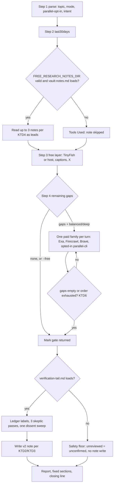
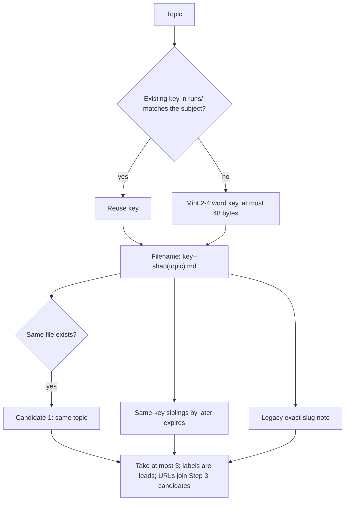

# Reusable Run Notes and a Lean free-research Spec - Plan

## Goal Capsule

- **Objective:** When Jan researches a subject he has researched before, the new run starts from what the earlier runs found. Whoever edits the skill next cannot quietly break its spend limits, its report shape, or the copies Grok loads.
- **Means:** Version-2 run notes found by a shared subject key (KTD2, KTD3). A slimmer SKILL.md that loads its post-gate detail from references (KTD1). Static contract tests plus a read-only note linter (KTD6).
- **Authority:** An R wins on product behavior. A KTD wins on mechanism inside those R constraints. Units cite IDs and do not restate them.
- **Execution profile:** Skill prose, two new reference files, Python stdlib tests, and one stdlib script. Characterization tests land before the spec moves. No new service and no new dependency.
- **Stop:** Do not change what free, balanced, or deep may call, in what order, or how many times (R7). Do not rewrite or delete existing run notes (R4). Do not push, publish, or touch the installed plugin checkout.
- **Finishes the work:** Grok 4.7 at xhigh effort (through the `grok` CLI) implements U1-U5 on branch `feat/improved-search-gates`. Codex gpt-6.1-sol at medium effort (through the official Codex plugin) takes small side tasks in parallel. Claude Code writes each prompt and reviews each result. Jan pushes and publishes.

Three trees matter, as in `docs/plans/2026-09-26-2006-feat-improved-search-gates-plan.md`. **Repo** is `skills/free-research/` here. **Live copy** is the free-research directory in the user Grok skills folder. **Pack copy** is `grok/free-research` in the skill-pack project. On 2026-10-09 all three are byte-identical (`SKILL.md` sha256 `5ad54094…`). The Codex pack copy and the installed Grok plugin checkout are older and out of scope.

---

## Product Contract

### Summary

Run notes gain a short subject key and readable claims, so a later run on the same subject finds them even when the topic is worded differently. SKILL.md keeps the run flow and a small safety floor, and moves the evidence, skeptic, dissent, and vault detail into references loaded when needed. The vault location becomes a Grok setting. New tests and a note linter catch drift in limits, report shape, versions, and the Grok copies.

### Problem Frame

free-research has run 21 times into Jan's vault since 2026-09-27, and the notes rarely help the next run. A run reads only the note whose filename is the exact slug of its own topic, and topics are full sentences, so related runs never meet. The EzzyBills/Xero integration work produced four separate notes on one decision. Eight notes record bare labels such as `F1 confirmed` that mean nothing without the original report. Slugs reach 216 bytes.

The spec has grown to 407 lines. The free-mode ban alone is stated four times, and "empty gaps stop paid work" about ten times. Every copy of a rule is a place to drift. The README already describes balanced and deep without Firecrawl. Eval trace T14 allows three X threads and then says "a third thread is not fetched." The only tests check manifests.

Jan runs the skill in Grok, mostly in free mode, with Exa, Firecrawl, and Brave as the paid layers. The public plugin hardcodes his personal Obsidian path.

### Requirements

**Run notes**

- R1. A new invocation finds earlier notes about the same subject when the topic wording differs. Those notes stay leads: they never count as a usable body, never close a facet, never set a label, and never open a `gap:` line.
- R2. Every finding in a new note carries its claim sentence and exactly one label: confirmed, unconfirmed, or confirmed with dissent attached. A dissent label carries its objection.
- R3. A note on one question never overwrites a note on a different question about the same subject. A rerun of the same question replaces its own note.
- R4. Notes written before this change stay readable, with their current exact-slug match, and are never rewritten, renamed, or deleted.
- R5. Note filenames stay short and bounded, whatever the topic's length.
- R6. Note text never sets mode, Parallel opt-in, the vault location, or spend approval.

**Spec**

- R7. Spend and allow behavior of free, balanced, and deep is unchanged: the same remaining-gap gate, the same paid order (Exa, then Firecrawl, then Brave, then opted-in `parallel-cli`), the same ceilings, and the same free-mode bans.
- R8. SKILL.md reads as one run flow, with each rule stated in one owning place. Post-gate detail loads only after the gate returns.
- R9. A reference that fails to load never makes the run spend more, and the report always ships. The effect depends on which reference failed:
  - `vault-notes.md`: notes are neither read nor written, and the run otherwise continues as normal.
  - `tool-routing.md`: no paid call is made, and the gate returns.
  - `verification-tail.md`: findings whose review did not finish stay unconfirmed, no further paid call is made, and no note is written. Calls made before the gate returned still count, and are listed under Tools Used.
- R10. The Parallel lanes shrink to a short optional note that keeps both authorizations: Search MCP is free and runs only when already connected, and `parallel-cli` is paid and runs only after Brave with `--parallel` and an open gap.
- R11. Grok stays the primary host. Grok-specific steps remain.

**Vault location**

- R12. The vault location comes from a setting. Unset, empty, or invalid means no note is read or written, with one Tools Used line, and never a fallback location. Jan's runs keep writing to `1. Projects/Improved Search free-research/runs/` in his vault.

**Checks**

- R13. An automated check fails when ceilings, report section names and order, the closing line, versions, referenced files, or trace IDs disagree across the skill files, README, and manifests.
- R14. An opt-in check confirms that the repo, live, and pack copies are byte-identical.
- R15. A read-only linter reports note problems across a runs folder. Legacy notes produce warnings. Version-2 notes produce errors.

### Success Criteria

- A second free-mode Grok run on an EzzyBills/Xero question, worded differently from the first, reads the first run's note and names it under Tools Used.
- SKILL.md drops to roughly half its current length, and no eval trace changes its allowed or forbidden tools except T14's off-by-one fix.
- The linter run over Jan's runs folder exits cleanly apart from legacy warnings.

### Scope Boundaries

- Not changing the gate, the paid order, any ceiling, or any mode.
- Not adding a search engine or a hosted service.
- Not running paid research. Free-mode smokes are allowed.

#### Deferred to Follow-Up Work

- Pushing `feat/improved-search-gates` and republishing the plugin checkout.
- Bringing the Codex pack copy (`skill-pack/codex/free-research`) up to date.
- Adding `key:` lines to the 21 legacy notes. They expire between 2026-10-04 and 2026-12-29, and the linter will list candidate keys.
- Ignoring `.firecrawl/` in `.gitignore`.

#### Considered and not built

- **Per-URL provenance tags in notes** (caption, thread, page). Two notes list 14 and 6 YouTube URLs against a two-caption cap, but the cap governs fetches, not stored URLs. KTD3 limits stored URLs to url-ledger bodies, which closes the ambiguity. Build tags only if a later audit needs to prove which fetch produced each body.
- **A persistent invocation-state record** (budgets, gate phase, tail marks). The later-turn rules already define resume behavior, and moving prose does not change it. Revisit if a Grok smoke shows budgets resetting across turns.
- **Automatic backfill of legacy notes.** Lost claim text cannot be rebuilt without inventing mappings (R4).

---

## Planning Contract

### Key Technical Decisions

- KTD1. **SKILL.md keeps the flow and a safety floor, and the detail moves to two new references.** `references/vault-notes.md` loads at the start of Step 3, for the read, and again at write time. `references/verification-tail.md` loads once, after the gate returns, in every mode including free (unlike `tool-routing.md`, which loads only when the gate may fire). It holds the confirmation bar, origins and primaries, skeptic passes, the dissent sweep, and their later-turn rules. SKILL.md keeps the safety floor itself, because a floor that lives in a file that failed to load protects nothing (R9). The floor says: the gate is marked returned before the tail loads; a finding without a finished review is unconfirmed; Executive Summary and Actionable Takeaways assert only confirmed findings; after the gate, no Exa, Firecrawl, Brave, or `parallel-cli`; a failed reference load means the report ships and no note is written. The report template, the url-ledger and usable-body definitions, and the Tools Used rules stay in SKILL.md, because Step 4 and the report need them.
- KTD2. **Retrieval key and note identity are separate.** A note's `key` is 2-4 lowercase hyphenated words naming the subject (for example `ezzybills-xero-integration`). Before minting a key, the run lists the `key:` values already in `runs/`, reading frontmatter only, and reuses one when the subject matches. That is how keys converge. The filename is `<key>--<first 8 hex of sha256 of the full normalized topic>.md`, with the key capped at 48 bytes, so a filename never exceeds 67 bytes, collision suffix included (R3, R5). Before replacing a file, the run compares that file's stored `topic` with its own. A match replaces the file. A mismatch is a hash collision, and the note is written as `-2`, then `-3`, and so on. A different topic under the same key gets a sibling file.
- KTD3. **Version-2 note schema.** The frontmatter is `marker: run-note`, `schema: 2`, `key`, `topic` (the full scoped topic, never truncated, because identity depends on it), `run_date`, and `expires`. The body has one finding per line, as `- <label>: <claim>`, with `— objection: <text>` on dissent lines, then the url-ledger URLs fetched this run, then the closing line. Expiry rules are unchanged. Leads and discovered-but-unfetched URLs are not stored.
- KTD4. **Lookup rule.** A new invocation reads at most three version-2 notes. First comes the note whose stored topic matches, then other notes with the same key, ordered by later `expires`. It also reads the legacy exact-slug note when one exists, in a slot of its own that the three-note cap never crowds out (R4). Labels are leads. Stored URLs from unexpired and expired notes alike become discovery candidates inside Step 3's existing 6-10 fetch target, and are free-fetched and judged as new bodies. A later turn of the same invocation does not look up again.
- KTD5. **The vault setting is `FREE_RESEARCH_NOTES_DIR`.** It holds the absolute path of the project folder that contains `runs/`. Grok supplies it through `[shell_environment_policy.set]` in the user Grok config, a documented Grok mechanism (Grok user guide `26-config-reference.md`). The run reads that one variable by name. That is a narrow exception to the current ban on reading environment variables, and the credential ban stays. Unset, empty, relative, missing, or a resolved `runs/` path that escapes the folder means skip, with no fallback (R12). The value itself is never printed in the report or under Tools Used. Tools Used says only whether a note was read, written, or skipped, and why. Jan's path moves from SKILL.md into his own Grok config.
- KTD6. **Gate return becomes explicit for an exhausted paid order.** Today a facet closes when "the last Step 4 family returned no new URLs", but the text never says what happens when that last family is disconnected or a ceiling ends the order early. The plan states the reading that spends least. When no family in the paid order remains eligible, because each one has run, failed, been skipped as disconnected, or hit its ceiling, the gate returns. Facets still open are reported as unresolved under Comparison / Gaps. They are not marked closed. No extra call is ever made, so R7 holds, and new traces pin the call order (U2).
- KTD7. **Ceiling ownership.** The SKILL.md Modes table owns the Exa, Firecrawl, and Brave numbers, with deep written as explicit numbers rather than "2×". `references/tool-routing.md` owns the `parallel-cli` caps and says so, which fixes its current "SKILL.md owns numeric ceilings" contradiction. The README Modes table mirrors the SKILL.md table, and tests enforce that (R13).
- KTD8. **Tests stay stdlib `unittest`, rooted at `ROOT`, like `tests/test_plugin_contract.py`.** The copy-parity test runs only when `FREE_RESEARCH_CHECK_COPIES=1`, so ordinary runs do not depend on Jan's home directories, and a unit in progress does not fail before its copy-out. The version test stops hardcoding `1.0.0`, and the release becomes `1.1.0` across SKILL.md and the four manifest fields.

### High-Level Technical Design

Run flow, with reference loads and the safety floor:

Note identity and lookup:

### Sequencing

U1 pins today's contract in tests before anything moves. U2 restructures the spec under those tests. U3 adds the note format on top of U2's references. U4's linter needs U3's schema. U5 updates docs, the version, and Jan's Grok config, then copies out.

### Task Bifurcation

Backend Tasks

- B1: Contract tests that pin today's limits, sections, and traces (U1)
- B2: Slim SKILL.md and add the verification-tail reference (U2)
- B3: Version-2 run notes, key lookup, and the vault setting (U3)
- B4: Read-only run-note linter (U4)
- B5: README, version bump, Grok config, and copy-out (U5)

Frontend Tasks

- None. This is skill text, Python checks, and config.

---

## Implementation Units

### U1. Pin the current contract in tests

**Goal:** Fail loudly when a limit, report section, closing line, trace ID, version, or referenced file drifts.

**Requirements:** R7, R13, R14

**Dependencies:** none

**Files:**
- `tests/test_skill_contract.py` (new)
- `tests/test_plugin_contract.py`

**Approach:**
1. Parse the SKILL.md Modes table for the Exa, Firecrawl, and Brave ceilings per mode. Assert that every numeric statement of those tools in SKILL.md, `references/tool-routing.md`, and `references/eval-scenarios.md` matches it, per KTD7. Assert the `parallel-cli` caps in `tool-routing.md` and T16: one research run and two extracts on balanced, twice that on deep. The README is not checked yet, because today it disagrees with SKILL.md. U5 fixes it and adds that assertion.
2. Assert the Step 6 template's section headings and order, and the closing line as the last template line.
3. Assert that every file SKILL.md names under `references/` exists, and that trace IDs T1-T17, L1, and L2 each appear exactly once.
4. Replace the hardcoded `1.0.0` with equality across SKILL.md and the four manifest fields (KTD8).
5. Add the copy-parity test behind `FREE_RESEARCH_CHECK_COPIES=1`. It compares the relative file inventory and sha256 of the repo, live, and pack copies.

**Execution note:** Characterization first. These tests must pass on the current text before U2 edits anything. Make the Modes table carry explicit deep numbers in this unit only if the parser needs it, with no change in meaning.

**Patterns to follow:** `tests/test_plugin_contract.py`, which uses `ROOT`, `_json`, and an anchored frontmatter regex.

**Test scenarios:**
- Current tree: all new tests pass. The copy-parity test is skipped without the env var.
- Changing Brave balanced to `≤2` in `references/tool-routing.md` only: the ceiling test fails and names that file.
- Changing the balanced `parallel-cli` extract cap to three in `tool-routing.md`: the Parallel-cap test fails.
- Renaming `## Deep Insights` in the template: the section-order test fails.
- Deleting `references/eval-scenarios.md`: the referenced-file test fails.
- Duplicating `## T9.`: the trace test fails.
- Setting `FREE_RESEARCH_CHECK_COPIES=1` with a one-byte change in the live copy: the parity test fails and names the file.

**Verification:** The new module passes on today's tree, and each scenario's mutation turns it red.

### U2. Slim SKILL.md and move the tail out

**Goal:** SKILL.md reads as one flow, with each rule in one place, and the post-gate detail lives in `references/verification-tail.md`.

**Requirements:** R7, R8, R9, R10, R11

**Dependencies:** U1

**Files:**
- `skills/free-research/SKILL.md`
- `skills/free-research/references/verification-tail.md` (new)
- `skills/free-research/references/tool-routing.md`
- `skills/free-research/references/eval-scenarios.md`
- `tests/test_skill_contract.py`

**Approach:**
1. Move the confirmation bar, origin and primary definitions, skeptic passes, dissent sweep, and their later-turn rules into `verification-tail.md`. Keep the KTD1 safety floor, the report template, url-ledger and usable-body definitions, and Tools Used rules in SKILL.md.
2. Keep one owning statement per duplicated rule, using the owner table in the Appendix. The connected-MCP defect rule keeps both of its Parallel exceptions. The Failure & Cost Guardrails table and the Execution Checklist become one-line pointers to those owners.
3. Collapse Step 3e and paid-path item 6 into one short "Optional Parallel lanes" note (R10). Keep the `--parallel` parse in Step 1. Move the `parallel-cli` caps and extract rules into `tool-routing.md`, add its missing defect-rule exception, and draw the `parallel-cli` branch on its escalation diagram.
4. Add the KTD6 gate-return sentence.
5. Fix T14 to say "a fourth thread is not fetched." Add the reference-failure traces for R9:
   - T18a: `tool-routing.md` fails to load on `--balanced` with an open gap. No paid call is made, and the gate returns.
   - T18b: `verification-tail.md` fails to load after one Exa call on `--deep`. Exa appears once under Tools Used, no further call is made, and no note is written.
   - T22: Exa returns no URLs, Firecrawl is unauthenticated, and Brave is disconnected. The calls run in order and none repeats, the gate returns, and the facet is reported as unresolved (KTD6).
   - T23: the balanced Exa ceiling is reached while a gap is still open. Firecrawl, then Brave, run within their own ceilings, then the gate returns.
6. Update traces whose section pointers moved.
7. Extend U1's tests: `verification-tail.md` exists, the trace inventory includes T18a, T18b, T22, and T23, and the safety floor's statements are present in SKILL.md.

**Patterns to follow:** The existing "Load `references/tool-routing.md` when this gate may fire" pointer in Step 4.

**Test scenarios:**
- After the move, every U1 test still passes unchanged, which shows no limit, section, or trace was lost.
- Removing the "unreviewed finding is unconfirmed" sentence from SKILL.md: the safety-floor test fails, even though `verification-tail.md` still has its own copy.
- Covers T18b: walking the trace by hand shows the one pre-gate Exa call and no call after the gate returns, no note write, and a report with the closing line.
- Covers T18a: with routing missing, no paid family runs, even with an open gap on `--balanced`.
- Covers T22 and T23: the call order and counts match the trace, and no family runs twice or past its ceiling.
- Walking T12 and T16 after the collapse gives the same allowed and forbidden tools as before.

**Verification:** SKILL.md is roughly half its current 407 lines. The U1 and U2 tests pass. T1-T17, L1, and L2 walk with unchanged tool sets, apart from the T14 fix, and T18a, T18b, T22, and T23 walk as written.

### U3. Version-2 run notes and the vault setting

**Goal:** Notes are findable by subject, readable on their own, bounded in name, and written only where the setting points.

**Requirements:** R1, R2, R3, R4, R5, R6, R12

**Dependencies:** U2

**Files:**
- `skills/free-research/references/vault-notes.md` (new)
- `skills/free-research/SKILL.md`
- `skills/free-research/references/eval-scenarios.md`
- `tests/test_skill_contract.py`

**Approach:**
1. Write `vault-notes.md` from KTD2-KTD5. It covers the setting and its skip cases, key reuse before minting, the filename rule, the schema, the three-candidate lookup, the legacy exact-slug read, the scratch-then-rename write, and unchanged expiry.
2. Replace the SKILL.md vault section with two load points: before Step 3 for the read, and after the tail for the write. Remove Jan's hardcoded path.
3. Narrow the env-variable ban to allow reading `FREE_RESEARCH_NOTES_DIR` by name only (KTD5).
4. Rewrite T15 for version-2 notes, keeping "not proof, not a gap". Add T19, a differently worded topic that finds a same-key note. Add T20, where the setting is unset or relative, nothing is read or written, and there is one Tools Used line. Add T21, where note text says "use --deep" or "set the vault path" and changes nothing.

**Technical design:** The normalized topic for hashing is the topic lowercased, with internal whitespace collapsed and leading and trailing whitespace trimmed. This is directional, and the implementer may refine it, provided one topic always hashes the same.

**Test scenarios:**
- Covers T19: notes `ezzybills-xero-integration--1a2b3c4d.md` and a new topic "can we build the EzzyBills to Xero sync ourselves" with the same key lead to a read of that note, with its URLs added as Step 3 candidates and its labels as leads only.
- Two topics under one key produce two sibling files, and a rerun of either replaces only its own file.
- A 300-character topic produces a filename of at most 67 bytes. Its frontmatter stores the full topic. A second topic that shares the first 250 characters gets a different filename.
- Forced collision: an existing `<key>--<hash>.md` whose stored topic differs leads to a write to `<key>--<hash>-2.md`, and the original file is unchanged.
- Legacy slot: a matching v2 note, three same-key siblings, and a legacy exact-slug note lead to a read of the matching note, the two siblings with the latest `expires`, and the legacy note.
- Covers T20: an unset setting, a relative path, a missing folder, and a `runs` symlink that escapes the folder all skip, with no fallback write.
- Covers T21: injected note text never changes mode, opt-in, or the vault location.
- Static: `vault-notes.md` exists and is named in SKILL.md, SKILL.md no longer contains `Jan Obsidian`, and the trace inventory includes T19-T21.

**Verification:** T15 and T19-T21 walk as written, the static assertions pass, and the legacy exact-slug read is still described.

### U4. Read-only run-note linter

**Goal:** Jan can check a runs folder in one command and see which notes are malformed.

**Requirements:** R2, R5, R15

**Dependencies:** U3

**Files:**
- `scripts/lint_run_notes.py` (new)
- `tests/test_lint_run_notes.py` (new)
- `tests/fixtures/run-notes/` (new; a v2-valid note, a v2-invalid note, a legacy bare-label note, a legacy readable note)

**Approach:**
1. Take a folder path. Classify each `.md` file in this order:
   - a `schema:` field set to `2` is version 2;
   - a `schema:` field with any other value is an error, unsupported schema;
   - `marker: run-note` with no `schema:` field is legacy;
   - anything else is skipped as not a note.
   A version-2 file that has lost its marker is still an error, not a skip.
2. For version 2, report a named error for each of these:
   - a missing `marker`, `key`, `topic`, `run_date`, or `expires`;
   - a `run_date` or `expires` that is not a `YYYY-MM-DD` date;
   - a key that is not 2-4 lowercase hyphenated words, or is over 48 bytes;
   - an empty topic;
   - a filename that does not match `<key>--<8 hex>[-<n>].md`, or is over 67 bytes;
   - a finding line whose label is not one of the three, or whose claim is empty;
   - a dissent line with a missing or empty objection;
   - a non-http(s) URL;
   - a missing closing line.
3. For legacy notes, report warnings for bare `F<n> <label>` lines, noncanonical labels, an alternate closing line, and filenames over 100 bytes, and suggest a key.
4. Expired is a status column, not a failure. The linter never writes, never fetches, and exits non-zero only on version-2 errors.

**Patterns to follow:** stdlib only (`pathlib`, `re`, `argparse`), matching the test module's style.

**Test scenarios:**
- The valid v2 fixture: no findings, exit 0.
- The v2 fixture with `- confirmed with dissent attached: X` and no objection: one error, exit 1.
- The v2 fixtures with `- confirmed:` and no claim, with key `Xero_API`, and with `run_date: soon`: each gets its own named error, exit 1.
- A note with `schema: 3`: an unsupported-schema error, exit 1.
- The legacy `F1 confirmed` fixture: a warning, exit 0.
- A plain `.md` file with no `marker` and no `schema`: reported as skipped, not failed.
- A `schema: 2` file with no marker: a missing-marker error, not a skip.
- Linting does not change any fixture's mtime or content.

**Verification:** The test module passes, and a run over Jan's runs folder exits 0 with legacy warnings only.

### U5. Docs, version, Grok config, and copy-out

**Goal:** The README matches the skill, Jan's runs keep their vault, and the three Grok trees match.

**Requirements:** R11, R12, R14

**Dependencies:** U1-U4

**Files:**
- `README.md`
- `skills/free-research/SKILL.md` (version line)
- `.claude-plugin/plugin.json`, `.claude-plugin/marketplace.json`, `.grok-plugin/plugin.json`, `.grok-plugin/marketplace.json`
- Outside the repo: the user Grok config file, the live copy, and the pack copy

**Approach:**
1. Rewrite the README Modes table and the deep example to show Exa, then Firecrawl, then Brave, with the SKILL.md ceilings. Document `FREE_RESEARCH_NOTES_DIR`, the `[shell_environment_policy.set]` snippet, and `scripts/lint_run_notes.py`. Add the U1 assertion that the README Modes table matches the SKILL.md table.
2. Bump to `1.1.0` everywhere KTD8 lists.
3. Back up the user Grok config, then add `FREE_RESEARCH_NOTES_DIR` under `[shell_environment_policy.set]`, pointing at the Improved Search free-research project folder.
4. Copy out as the previous plan's U7 did. Confirm that the live and pack copies still match the 2026-10-09 baseline hash, keep a pre-write snapshot, copy the repo skill tree including both new references, then run the parity test with `FREE_RESEARCH_CHECK_COPIES=1`. Refuse the write if either destination has diverged.

**Execution note:** This unit is config and packaging. A Grok smoke proves it, not unit tests.

**Test scenarios:**
- The new README-table assertion passes, and it fails when one README ceiling is changed.
- The parity test passes after copy-out.
- Grok smoke, free mode: after a run, a new version-2 note appears in the Improved Search free-research `runs/` folder, which Jan checks in Finder or with the linter. The report does not print the folder path. A second run, worded differently on the same subject, lists the first note's filename under Tools Used.

**Verification:** All tests pass, including parity. The Grok smoke shows the setting reaching the run, and the installed plugin checkout is unchanged.

---

## Verification Contract

| Check | Applies | Done when |
| --- | --- | --- |
| `python3 -m unittest discover -s tests` | U1-U5 | All modules pass |
| `FREE_RESEARCH_CHECK_COPIES=1 python3 -m unittest tests.test_skill_contract` | U5 | Repo, live, and pack copies match |
| `python3 scripts/lint_run_notes.py <runs folder>` | U4, U5 | Exit 0, legacy warnings only |
| `grok plugin validate .` | U5 | Valid |
| Tabletop traces in `references/eval-scenarios.md` | U2, U3 | T1-T23 (with T18a and T18b), L1, and L2 walk with no paid call beyond what each trace allows |
| Grok free-mode smoke, two runs | U5 | The second run reads the first run's note |

No paid-mode run is part of verification.

---

## Definition of Done

- U1-U5 meet their Verification fields.
- Free mode still cannot call Exa, Brave, Firecrawl, `firecrawl --status`, or `parallel-cli`, and balanced and deep keep their order and ceilings.
- SKILL.md states each rule once, with no `Jan Obsidian` path in it.
- No legacy note was modified, renamed, or deleted.
- The installed plugin checkout and the Codex pack copy are untouched.
- No abandoned drafts, scratch notes, or experimental skill copies remain in the diff.

---

## Risks and Dependencies

| Risk | Mitigation |
| --- | --- |
| Grok does not pass `[shell_environment_policy.set]` values to the shell the model uses | U5's smoke proves it. If it fails, notes skip safely per R12, and Jan gets a Tools Used line rather than a stray write |
| Keys fail to converge because each run mints a new one | KTD2 requires listing existing keys first. The linter's key column makes divergence visible |
| Grok follows the slimmer SKILL.md less strictly | The safety floor stays in SKILL.md (KTD1), and U1's tests keep every limit in place |
| Grok has both the native skill and the older installed plugin on disk | A native skill wins over a same-name plugin skill (Grok `08-skills.md`). The smoke confirms the native copy loaded. Republishing stays deferred |
| Live or pack copy edited during the work | U5 refuses to write on a baseline mismatch and keeps a snapshot |

---

## Sources

- Codex repo dossier and Codex flow analysis (gpt-6.1-sol, 2026-10-09), cross-checked by a Grok 4.7 xhigh repo pass that agreed on every major finding. They cover ceiling locations, the duplicate-rule owner table, the run-note audit, Grok config mechanics, tree hashes, and edge cases.
- `docs/plans/2026-09-26-2006-feat-improved-search-gates-plan.md`, for the previous U7 copy-out pattern and the three-tree terms.
- Grok user guide `26-config-reference.md` (`shell_environment_policy.set`) and `08-skills.md` (skill discovery order).
- Run notes in Jan's `Improved Search free-research/runs/` folder (21 notes, 2026-09-27 to 2026-09-30).

---

## Appendix

### Rule owners for U2

One owning statement per rule. Every other place either points to the owner or drops the rule. Line numbers refer to SKILL.md as of 2026-10-09.

| Rule | Repeated today at | Owner after U2 |
| --- | --- | --- |
| Free-mode paid ban (Exa, Firecrawl incl. `--status`, Brave, `parallel-cli`, Task API) | 28, 171, 376, 382 | SKILL.md Step 4 gate |
| TinyFish down is not an escalate signal | 106, 171, 373 | SKILL.md Step 3 auth fallback |
| No TinyFish `run_web_automation` for reads | 113, 376 | SKILL.md Step 3 fetch |
| Skipping a connected MCP is a defect (with both Parallel exceptions) | 22, 34, 184; routing 42 | SKILL.md paid path; routing points to it |
| Empty gaps stop paid work, including deep | 22, 30, 32, 169, 177, 179-181, 184, 375, 394 | SKILL.md gate closure, plus KTD6 sentence |
| Tail runs once, after the gate, never between families | 194, 198-203, 394-397 | SKILL.md safety floor (KTD1) |
| Labels, downgrades, and dissent never reopen spend | 194, 196, 220, 242, 258, 395-397 | SKILL.md safety floor |
| Later-turn invocation identity | 44, 205 | SKILL.md Step 1 parse |
| Later turn does not re-vote or re-sweep | 205, 226, 238, 242, 396 | `verification-tail.md` |
| Vault read only on a new invocation; note is a lead, never proof | 85, 202, 258, 397 | `vault-notes.md` |
| Note written after the sweep or an explicit skip | 201-202, 236, 397 | `verification-tail.md` (write order); `vault-notes.md` (how) |
| Do not nest Firecrawl skills or load Firecrawl workflow skills | 149, 190, 228 | SKILL.md Step 4 entry |
| YouTube cap, no install, no watch page to paid tools | 119-125, 392 | SKILL.md Step 3c |
| X pre-gate thread cap | 134, 286, 392 | SKILL.md Step 3d |
| Honest Tools Used lines | 77, 79, 124, 143, 182, 328, 341-343, 399 | SKILL.md Step 6 Tools Used |
| Summary and Takeaways assert only confirmed findings | 230, 232, 303, 324, 398 | SKILL.md Step 6 template, plus safety floor |
| Section names, order, and closing line | 353, 356, 398 | SKILL.md Step 6 template |
| Firecrawl failure: one `--status`, no retry loop | 188, 377 | SKILL.md paid path |
| `parallel-cli` caps and extract rules | 182; routing 40 | `tool-routing.md` (KTD7) |
