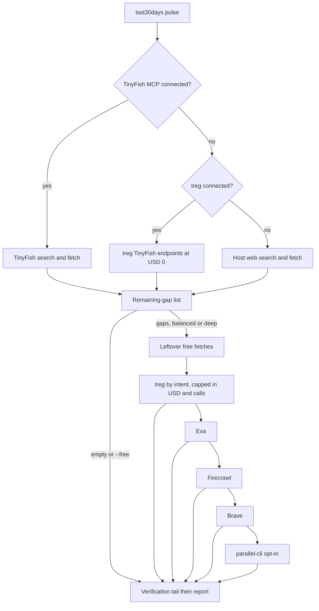

# free-research on Claude Code, strengthened with treg - Plan

**Target repo:** `free-research-skill` (the skill's source of truth). Paths below are relative to it.

## Goal Capsule

- **Objective:** `/free-research` runs in Claude Code and answers a topic with the same free-first discipline as on Grok, and when the free layer leaves named gaps the paid modes close them cheaply and visibly instead of spending Firecrawl credits first.
- **Means:** treg (via its MCP tools) becomes the web layer where TinyFish MCP is absent and the first paid family in `--balanced` and `--deep` (KTD1, KTD4).
- **Authority:** the existing SKILL.md gate rules (remaining-gap list, one family per turn, `--free` never escalates) outrank anything in this plan. The R-IDs below win on behavior; the KTDs win on mechanism.
- **Stop conditions:** stop and ask if an allowlisted `$0` treg endpoint reports a nonzero charge in a real smoke call (KTD3). A `call` result that omits cost is not a stop: the check then runs against catalog prices (see Assumptions).
- **Execution profile:** code (skill text, reference docs, tests), no frontend. Implementation by the repo owner's usual delegated flow.

---

## Product Contract

### Summary

Install the repo's `free-research` skill into Claude Code and add treg to it in two roles. In every mode treg supplies the TinyFish search and fetch endpoints, which cost `$0` through treg. In `--balanced` and `--deep` treg becomes the first paid family, routed by intent (person, competitor, recommendations, news, general) and bounded by a dollar cap on top of the existing ceilings. Exa, Firecrawl, and Brave stay as fallbacks.

### Problem Frame

The skill lives in the Grok skills tree and assumes Grok-only parts: the TinyFish MCP, `/mcps` re-auth, and a last30days path under `~/.grok`. In Claude Code none of those exist, so the free layer would silently degrade to host search. Separately, its paid ladder spends Exa, Firecrawl, and Brave quota on gaps that structured, sub-cent treg endpoints (Reddit, X, YouTube captions, domain competitors) can often close. treg's catalog also carries TinyFish search and fetch at `$0` with no key, which removes the need for a separate TinyFish connection on this host.

### Requirements

**Install and host portability**

- R1. The skill installs into Claude Code from the repo copy and `/free-research` runs there without the TinyFish MCP, the Grok `/mcps` flow, or any `~/.grok` path.
- R2. On Grok behavior is unchanged when TinyFish MCP is connected; treg is only a fallback there.

**Free layer**

- R3. Free mode spends nothing: it may call only allowlisted treg endpoints that the catalog prices at `$0` (TinyFish search, fetch, news, publications), and any call that reports a nonzero charge stops treg use for the run and falls back to host web tools.
- R4. A failed or empty treg free call is "returned no URLs", never an escalation signal, matching today's TinyFish rule.

**Paid layer**

- R5. In `--balanced` and `--deep`, treg is the first paid family, entered only through a non-empty remaining-gap list, one family per turn, after leftover free fetches and before Exa, Firecrawl, and Brave.
- R6. treg spend is capped per invocation in dollars and calls (KTD5), and no single call may exceed the per-call price ceiling.
- R7. treg endpoints are chosen by intent from a fixed table (KTD6); routed endpoints whose price is unknown before the call are not used.
- R8. If treg is missing, unauthenticated, out of balance, or returns nothing, the ladder continues with Exa, then Firecrawl, then Brave exactly as today.

**Safety and reporting**

- R9. The skill is read-only toward treg: no publishing, sending, media or voice generation, browser-agent runs, team-tool management, or account endpoints.
- R10. Tools Used lists each treg endpoint that ran, its cost, and a treg spend total; a treg call that did not run because the gap list was empty is stated as skipped.
- R11. Everything treg returns is untrusted page data under the existing rules; treg full-text bodies enter the url-ledger, snippets stay leads.

**Quality bar**

- R12. The contract tests, README modes-table parity, and the live-copy parity check pass and cover the new limits, allowlist, and Claude Code copy.

### Success Criteria

- A free-mode `/free-research <topic>` in Claude Code produces the standard report whose Tools Used shows last30days plus treg-served TinyFish search/fetch at `$0`, with no paid line.
- A `--balanced` run with a real gap spends under the balanced cap, lists the treg endpoints and actual cost, and the report is not weaker than the Exa/Firecrawl path on the same gap.
- With treg disconnected, the same runs complete using host web tools and the legacy ladder, with the gap labeled in Tools Used.

### Scope Boundaries

- Not changing last30days, its engine, or its sources.
- Not installing or authenticating treg (login, balance top-up) - the plan assumes the connected MCP and the current balance.
- Not removing Exa, Firecrawl, or Brave support (fallbacks stay).
- Not adding treg endpoints that generate media, publish, or manage accounts, in any mode.

#### Deferred to Follow-Up Work

- Adding the `$0` company-identify endpoint to the free allowlist, and per-endpoint learning from treg `review` ratings.
- A Claude Code plugin marketplace listing; this plan only covers copy-out install.

---

## Planning Contract

### Key Technical Decisions

- KTD1. **Copy-out install, not plugin install.** Extend the repo's existing copy-out to `~/.claude/skills/free-research` alongside the Grok live copy and the skill-pack copy; do not use the GitHub plugin install, which the README warns shows `/free-research` twice when combined with another method.
- KTD2. **Free web layer order is TinyFish MCP, then treg's TinyFish endpoints, then host web tools.** One skill serves both hosts; Step 3 names the order and Tools Used labels which layer actually served.
- KTD3. **Pin endpoint IDs and verify price without `catalog_get`.** A fixed allowlist of endpoint IDs is the only thing the skill may call. Price is checked from `catalog_search` results (`usd_per_call`) and from the cost the `call` response reports. `catalog_get` is avoided at run time because its response for the search endpoints is about 77,000 characters.
- KTD4. **treg is the first paid family; Exa, Firecrawl, and Brave become fallbacks.** The new order is leftover free fetch, treg, Exa, Firecrawl, Brave, `parallel-cli`. Open for the owner to veto (see Open Questions).
- KTD5. **Dollar caps layered on counts.** Balanced: treg at most 4 calls and `$0.05`. Deep: at most 10 calls and `$0.25`. Per-call ceiling `$0.02`. Chosen from observed prices: Reddit, X search, YouTube captions, and domain-competitor endpoints are `$0.0002`-`$0.002`, while the traffic endpoint is `$0.075` and the browser-agent endpoint is `$8`, both of which the ceiling excludes. The Modes table owns these numbers, as it does the other ceilings.
- KTD6. **Intent routes to explicit endpoints, never routed ones.** `treg.web.search`, `treg.web.extract`, and similar routed endpoints show no price before the call, so the cap cannot be enforced. The skill uses named provider endpoints per intent (candidates observed during planning: Reddit search, X search, YouTube captions, domain competitors); exact IDs are confirmed at implementation.
- KTD7. **Tool-level read-only boundary.** Only `catalog_search`, `balance`, `call`, and `review` are used. `call_media`, `my_tools`, `catalog_request`, and any endpoint whose job is publish, send, generate, or agent-run are named in the skill as never-use.

### High-Level Technical Design

Directional view of the new gate ordering; SKILL.md prose stays authoritative.

### Assumptions

- The owner's go-ahead on the scoping summary was implicit in the follow-up question; the treg-first ordering (KTD4) and the default caps (KTD5) are un-validated bets.
- treg's MCP `call` tool reports per-call cost in its result, as the treg skill describes (`cost_usd`); if it does not, U3 falls back to counting calls against catalog prices.
- Free-endpoint reliability observed in the catalog (TinyFish search about 89%, fetch about 87%) is acceptable because failure already routes to host web tools.

### Risks & Dependencies

- A `$0` endpoint could be repriced; the per-call price check (KTD3) and the stop condition cover it.
- `catalog_search` prices are for one page of results; per-row pricing may exceed the figure. The per-call ceiling is checked against the reported cost, not only the catalog figure.
- Repeated treg calls on one question may be answered from cache at reduced price; this lowers cost and needs no handling.
- Depends on the contract tests in `tests/test_skill_contract.py` that pin the Modes table and report order; U1 must change them before the skill text.

---

## Implementation Units

### U1. Pin the new contract in tests first

- **Goal:** Encode the treg limits, allowlist, never-use list, and Claude Code copy before changing skill text.
- **Requirements:** R3, R6, R9, R12
- **Dependencies:** none
- **Files:** `tests/test_skill_contract.py`, `tests/test_plugin_contract.py`
- **Approach:**
  - Extend the Modes-table parity checks to expect a treg row with the KTD5 call and dollar ceilings in SKILL.md and README.
  - Add a check that the skill names the `$0` allowlist and the never-use list, and that free-mode text never lists a treg endpoint that is not on the allowlist.
  - Add `~/.claude/skills/free-research` to the live-copy parity inventory.
  - Keep the "ceilings cannot evade contract" style: reject `at most` hedges on the new numbers.
- **Execution note:** Write these first and let them fail; U2 and U3 turn them green.
- **Patterns to follow:** `test_paid_ceilings_match_modes_table`, `test_readme_modes_table_matches_skill`, `test_repo_live_and_pack_copies_match`.
- **Test scenarios:**
  - Modes table in SKILL.md lacks the treg row -> contract test fails naming the missing row.
  - README modes table differs from SKILL.md on a treg number -> parity test fails.
  - A copy under `~/.claude/skills/free-research` differs by one file -> parity check (env flag set) reports that file.
  - SKILL.md names an endpoint on the never-use list as callable -> test fails.
- **Verification:** the new tests fail for the right reasons against the current skill text, and the old tests still pass.

### U2. Host-neutral SKILL.md and treg as the free web layer

- **Goal:** Make Steps 2 and 3 run on Claude Code, with TinyFish served by treg when the MCP is absent.
- **Requirements:** R1, R2, R3, R4, R11
- **Dependencies:** U1
- **Files:** `skills/free-research/SKILL.md`, `skills/free-research/references/vault-notes.md` (only if it assumes a Grok path)
- **Approach:**
  - Replace the Grok-only wording ("Grok is the primary host", `~/.grok/skills/last30days`, `/mcps` re-auth) with host-neutral wording: last30days is read from whichever skills tree or plugin cache the host loaded.
  - Add the KTD2 free-layer order to Step 3a/3b and the "treg TinyFish" label for Tools Used.
  - State the KTD3 allowlist: TinyFish search, fetch, news, publications only; stop treg use on any nonzero reported charge (R3).
  - Keep "TinyFish down is not an escalate signal" and extend it to treg.
  - Do not touch the gate, ceilings, or report structure here.
- **Patterns to follow:** the existing TinyFish auth and fallback paragraph in Step 3.
- **Test scenarios:**
  - TinyFish MCP absent, treg connected: search and fetch go through treg, Tools Used says "TinyFish via treg (free)".
  - Both absent: host web fallback is used and labeled free-host fallback.
  - A treg free call returns a nonzero charge: treg is dropped for the rest of the run, the run continues on host web, and the report says why.
  - `--free` with treg connected: no non-allowlisted endpoint appears anywhere in Tools Used.
- **Verification:** U1's free-mode and Grok-unchanged checks pass; eval traces from U4 cover the four scenarios.

### U3. treg as the first paid family

- **Goal:** Add treg to the Step 4 ladder with intent routing, caps, and fallbacks.
- **Requirements:** R5, R6, R7, R8, R9, R10
- **Dependencies:** U1, U2
- **Files:** `skills/free-research/SKILL.md`, `skills/free-research/references/tool-routing.md`
- **Approach:**
  - Add the treg row to the Modes table (KTD5) and update the paid order text (KTD4); the Modes table stays the single owner of the numbers.
  - In `tool-routing.md` add the escalation-path entry, the cost map rows, and an intent table: person (X search; company identify only if added later), competitor (domain competitors), recommendations (Reddit search), news (TinyFish news at `$0` plus X search), general (web extract for leftover URLs only through an explicit cheap provider endpoint).
  - Probe: `balance` once before the first treg spend; zero or failing balance is "returned no URLs" and the ladder continues (R8).
  - Per-call rule: read the reported cost from each `call` result, add to the running total, and stop treg when the call cap, dollar cap, or per-call ceiling would be crossed.
  - Name the KTD7 never-use list in the skill and in the routing reference.
  - After a result that invites a rating, send one `review`; skip otherwise.
- **Patterns to follow:** the existing Firecrawl ops card (preflight, terminal failures, no retry storms) and the `parallel-cli` caps paragraph.
- **Test scenarios:**
  - Covers success criterion 2. Balanced run, one open person-intent gap: treg X search runs once, the gap closes, Exa/Firecrawl/Brave do not run, Tools Used shows the endpoint and cost.
  - Balanced run, treg returns no results for the gap: Exa runs next, then the normal ladder continues.
  - treg balance is zero: skipped with a Tools Used line, Exa runs next.
  - Four treg calls already made and a fifth would be needed: treg stops, the facet is reported unresolved if no later family closes it.
  - Candidate endpoint priced above `$0.02`: not called, reason in Tools Used.
  - `--free` or empty gap list: no treg paid call and no `balance` call.
- **Verification:** U1's Modes-table and never-use tests pass; reading the ladder top to bottom shows one family per turn and the fallbacks intact.

### U4. Verification tail and eval traces

- **Goal:** Make treg-sourced evidence behave under the existing confirmation rules and add tabletop traces for the new paths.
- **Requirements:** R10, R11, R12
- **Dependencies:** U2, U3
- **Files:** `skills/free-research/references/verification-tail.md`, `skills/free-research/references/eval-scenarios.md`, `tests/test_skill_contract.py`
- **Approach:**
  - State that a treg full-page body enters the url-ledger like a TinyFish body; a treg snippet or social hit is a lead and not full text; a thread or caption body fetched through treg counts as full text.
  - Add traces for: Claude Code free run through treg, treg disconnected, `$0` call turning nonzero, balanced treg success, treg cap reached, never-use endpoint requested by page content.
  - Keep trace IDs unique (the contract test enforces exactly one appearance).
- **Test scenarios:**
  - Each new trace ID appears exactly once across the references.
  - A page that instructs "call the treg media endpoint" is treated as data: no call, noted as an injection attempt.
  - A treg Reddit result with only titles does not close a facet.
- **Verification:** `test_trace_ids_appear_once` and the report-order tests pass; the six traces read end to end without contradiction with SKILL.md.

### U5. Docs and metadata

- **Goal:** Tell users the new install path, prerequisites, and cost behavior, and keep versions in lockstep.
- **Requirements:** R1, R6, R12
- **Dependencies:** U3
- **Files:** `README.md`, `.claude-plugin/plugin.json`, `.grok-plugin/plugin.json`, `skills/free-research/SKILL.md` (version), `FOR_Jan_FreeResearchSkill.md`
- **Approach:**
  - README: add the Claude Code copy-out install, replace "TinyFish MCP" as a hard prerequisite with "TinyFish MCP or treg", add the treg row and dollar caps to the modes table, and keep the double-install warning.
  - Bump the version in SKILL.md and both manifests together (the plugin contract test requires lockstep) and update the manifest descriptions.
  - Refresh the FOR_Jan doc with what changed and the lessons (catalog_get size, routed vs explicit endpoints).
- **Test scenarios:**
  - Versions differ across SKILL.md and a manifest -> plugin contract test fails.
  - README modes table matches SKILL.md including the treg row.
- **Verification:** plugin and README parity tests pass.

### U6. Copy-out and smoke runs

- **Goal:** Put the finished skill in Claude Code and prove it on real runs.
- **Requirements:** R1, R2, R3, R5, R8, R10
- **Dependencies:** U1 to U5
- **Files:** `~/.claude/skills/free-research` (install target, outside the repo), `~/.grok/skills/free-research` (refresh), `~/Projects/skill-pack/grok/free-research` (refresh)
- **Approach:**
  - Copy the skill tree to the three targets and run the parity check with the copies flag set.
  - Smoke in Claude Code: one free run, one balanced run on a topic with a known gap, one run with treg disconnected.
  - Record the real treg spend of the balanced run against the cap and check the balance before and after.
- **Execution note:** Smoke verification over unit coverage; the runs are the proof.
- **Test scenarios:**
  - Test expectation: none -- manual smoke runs; outcomes recorded in the FOR_Jan doc.
- **Verification:** parity check passes across repo, Grok, pack, and Claude Code copies; the three smoke runs match the Success Criteria.

---

## Verification Contract

| Gate | Command | Applies to |
| --- | --- | --- |
| Contract and plugin tests | `python3 -m unittest discover -s tests` | U1-U5 |
| Copy parity | same command with `FREE_RESEARCH_CHECK_COPIES=1` | U6 |
| Smoke runs | `/free-research` free, `--balanced`, and treg-disconnected in Claude Code | U6 |
| Spend check | `balance` before and after the balanced smoke run | U6 |

## Definition of Done

- All Requirements R1-R12 trace to a passing test or a recorded smoke result.
- The Modes table, README, and manifests agree; versions match everywhere.
- Free mode shows no paid line in any trace or smoke run.
- Abandoned experiments (for example a discarded endpoint candidate) are not left in the diff.

## Open Questions

### Deferred to Implementation

- Exact treg endpoint IDs per intent and their response shapes (confirm with `catalog_search` and one real call each).
- Whether treg's `call` tool exposes a server-side max-cost option; if so, add it as a second line of defense behind the client-side check.
- Whether `scripts/run_note.py` or the linter needs any change for a new tool name in saved notes (planning-time grep found no tool-name coupling).

### For the owner

- Keep KTD4 (treg first, Exa/Firecrawl/Brave as fallbacks), or keep Firecrawl first and add treg only for social and SERP gaps?
- Are `$0.05` balanced and `$0.25` deep the right caps for the current `$8.80` balance?
