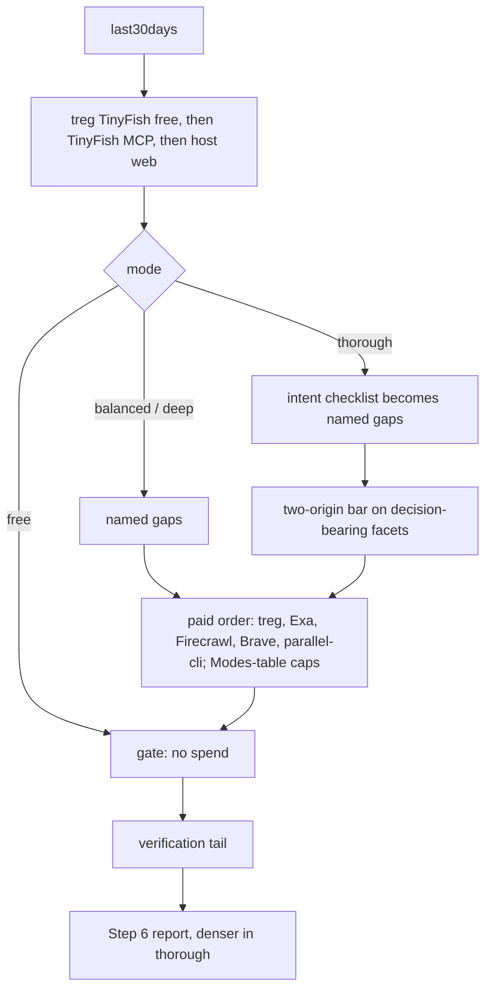
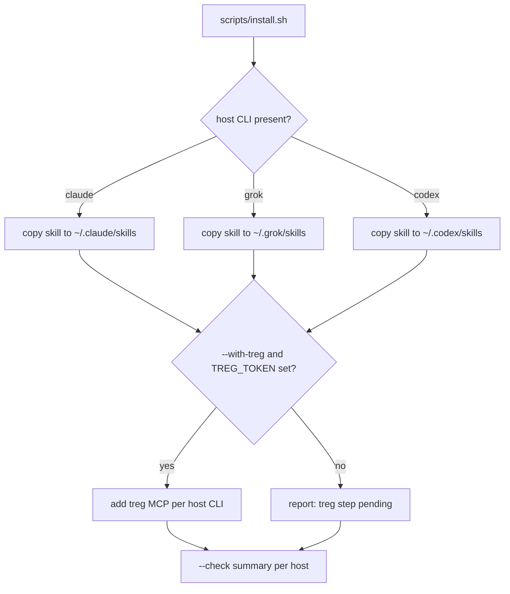

# free-research --thorough mode, treg-first, portable install - Plan

## Goal Capsule

- **Objective:** Jan can run `/free-research` the same way in Claude Code, Grok, and Codex on any of his Macs. He starts free and escalates through balanced, deep, and a new thorough level until the report holds enough detail that he does not have to search again himself.
- **Means:** treg becomes the first free web layer on every host (KTD1). A new `--thorough` mode sits above `--deep` (KTD2, KTD3). A repo install script with a check mode replaces per-host manual copying (KTD5).
- **Authority:** SKILL.md's gate rules and Modes table stay the single owner of spend. R-IDs win on behavior; KTDs win on mechanism.
- **Stop conditions:** Stop and ask if the install script would need to write or print a treg token. Also stop and ask if thorough cannot stay inside its caps without weakening the existing free/balanced/deep rules.
- **Execution profile:** Implementation by Codex gpt-6.1-sol at medium effort. Claude Code writes the prompts, reviews diffs, runs tests, commits, and runs smokes.

---

## Product Contract

### Summary

Keep `--free` as the default and add `--thorough` as the top escalation level. Thorough does not stop at the first adequate answer: it works through a coverage checklist for the topic's intent, wants two independent sources on decision-bearing facets, and writes a denser report, under its own cost caps. Make treg the first free web layer on every host. Ship an install script that puts the skill and the treg MCP connection on Claude Code, Grok, and Codex on any Mac, plus a check mode that reports what is missing. Finish by fixing treg on Codex on this Mac and verifying every mode across the three hosts.

### Problem Frame

v1.2.1 works in Claude Code and Grok, but Jan cannot rely on it day to day. Codex has the skill but no working treg auth because `TREG_TOKEN` is unset. The free web layer prefers the TinyFish MCP, which keeps expiring ("auth required" in the Grok runs), so different hosts take different paths. Installing on another computer means following three different instructions, one of which (the Grok marketplace plugin) installs a stale v1.0.0 copy. When a free report is not detailed enough, Jan escalates to balanced and then deep. Deep still stops as soon as each named facet has one usable page, so "enough detail that I don't search again" has no mode that delivers it.

### Requirements

**Mode ladder**

- R1. `--free` stays the default, and the free, balanced, and deep modes keep their current behavior and caps.
- R2. `--thorough` is a new mode above deep. It runs the same free layer and paid order, under its own caps in the Modes table.
- R3. Thorough builds a coverage checklist for the topic's intent before the gate. Each checklist item the free layer did not answer becomes a named gap.
- R4. In thorough, a decision-bearing facet stays open until it has two independent origins or one primary source, and the report says which facets fell short.
- R5. Thorough reports carry concrete detail in every section: numbers, prices, dates, versions, and attributed quotes. The section order and closing line stay unchanged.

**One web tool**

- R6. On every host the free web order is treg's zero-priced TinyFish allowlist, then TinyFish MCP, then host web. Failure semantics and the zero-spend rule are unchanged.

**Portable install**

- R7. One repo script installs or updates the skill for every supported host present on the Mac (Claude Code, Grok, Codex), without symlinks and without overwriting newer edits silently.
- R8. With an opt-in flag, the script adds the treg MCP connection to each host from a `TREG_TOKEN` environment variable. The token is never printed, logged, or written into the repo or skill files.
- R9. A check mode reports per host:
  - whether the skill is installed and at which version;
  - whether last30days is present;
  - whether treg MCP is configured;
  - whether an older duplicate install exists;
  - whether `FREE_RESEARCH_NOTES_DIR` is set, without printing its value.
- R10. Skill files keep no machine-specific paths, so the same tree works on any Mac.

**This Mac and proof**

- R11. treg works in Codex on this Mac after Jan supplies the token.
- R12. Free and balanced pass end to end on Claude Code, Grok, and Codex, and thorough passes on at least one host. Each run's reported treg spend must match the balance change.

### Success Criteria

- A free report Jan judges "not enough", re-run with `--thorough` on the same topic, answers the checklist items or lists each one it could not answer. Treg spend stays at or under the thorough cap.
- On a fresh Mac, `scripts/install.sh` with the check mode lists exactly the steps still needed, and a second run after those steps reports all green.
- No run in any host lists TinyFish MCP before treg in Tools Used unless treg failed.

### Scope Boundaries

- No change to the free, balanced, or deep caps, the paid order, or the report template sections.
- Not fixing the Grok CLI itself (it can hang after `end_turn`). Smokes use a timeout instead.
- No Windows or Linux install support. No changes to last30days.
- No treg account setup, top-up, or token issuance. Jan supplies and rotates the token.

#### Deferred to Follow-Up Work

- Allowing capped routed `treg.*` endpoints (`X-Treg-Route-Max-Cost`) as a cheaper general-extraction path. Now done for `treg.web.extract`, a header-capped paid fallback; only `treg.web.search`, `treg.companies.enrich`, and `treg.x.search.posts` stay never-use.
- A shared helper that reads per-call treg charges, so a spend mismatch can be attributed without timing analysis.

---

## Planning Contract

### Key Technical Decisions

- KTD1. **treg first in the free web layer on every host.** (session-settled: user-directed - chosen over the v1.2.1 order where TinyFish MCP goes first and treg is the fallback: Jan wants one web tool, treg, on all hosts.) Cost is identical (both USD 0); the gain is one auth and one path.
- KTD2. **Free stays the default; thorough is an escalation above deep.** (session-settled: user-directed - chosen over making `--balanced` the default: Jan escalates free → balanced → deep → thorough only when a report is not enough.)
- KTD3. **Thorough caps.** treg at most 25 calls / USD 0.50 total / USD 0.02 per call. Exa at most 6, Firecrawl at most 10 leftover ops, Brave at most 3. `parallel-cli` caps stay as for deep. Thorough data spend therefore stays near ten times deep's treg budget, and its main cost is model time.
- KTD4. **Coverage checklist lives in Step 5 intent handling, one list per intent.** The checklist turns into named facets before the gate, so the existing gap machinery does the work and no new gate is invented. Only thorough requires the full checklist. Other modes may use it as angle hints only.
- KTD5. **A shell install script in the repo, with `--check` and `--with-treg`.** It uses each host's own CLI to add MCP servers:
  - `claude mcp add --transport http -H`
  - `grok mcp add -H`
  - `codex mcp add --url --bearer-token-env-var TREG_TOKEN`

  The token goes in by reference (Codex) or straight into the host's own config file (Claude Code, Grok), never into the repo. Copy, not symlink, as today.
- KTD6. **Smokes run with a hard timeout and paid-tool denies, and read the host session log when stdout is empty.** This covers the Grok hang observed on 2026-10-19.

### High-Level Technical Design

Mode ladder and where thorough differs (directional; SKILL.md prose is authoritative):

Install flow (directional):

### Assumptions

- Each host's MCP add command stores the header in that host's own user config, which is outside the repo and acceptable to Jan.
- Codex reads `TREG_TOKEN` from the environment of the shell or app that launches it. Exactly where to export it (`~/.zshenv` vs the app's environment) is settled at implementation by testing.

### Risks & Dependencies

- Thorough runs cost more model time (estimated 1.5-2x deep). The data caps bound money spent on data, not model cost.
- TinyFish via treg uses treg's TinyFish account; its rate limit may be shared. TinyFish MCP and host web remain fallbacks.
- The Grok marketplace plugin install (v1.0.0) coexists with the native copy. The check mode flags it, and removal stays Jan's choice.
- Contract tests pin `MODES = ("free", "balanced", "deep")`, the Modes-table parity, and the "TinyFish MCP, then TinyFish via treg" phrase. U1 must change them first.

---

## Implementation Units

### U1. Pin the new contract in tests

- **Goal:** Tests describe thorough, treg-first, and the install script before any skill text changes.
- **Requirements:** R1, R2, R6, R7, R8, R9, R10
- **Dependencies:** none
- **Files:** `tests/test_skill_contract.py`, `tests/test_plugin_contract.py`, `tests/test_install.py` (new)
- **Approach:**
  1. Add `thorough` to the modes the parsers accept, and expect the KTD3 treg row and Exa/Firecrawl/Brave counts in SKILL.md and README.
  2. Replace the host-order assertion with the KTD1 order. Assert the old "TinyFish MCP stays first" sentence is gone.
  3. Keep every existing free/balanced/deep expectation unchanged (R1).
  4. New `test_install.py` runs the script against a temporary `HOME` with fake `claude`, `grok`, and `codex` executables on `PATH` that record their arguments.
- **Execution note:** Write these first and watch them fail for the right reason.
- **Patterns to follow:** `test_treg_limits_and_readme_parity`, `test_readme_modes_table_matches_skill`, `test_repo_live_and_pack_copies_match`.
- **Test scenarios:**
  - Modes table lacks a thorough row: parity test fails naming thorough.
  - README thorough row differs from SKILL.md: parity test fails.
  - SKILL.md still says TinyFish MCP first: order test fails.
  - Install into an empty temp HOME with all three fake CLIs: three skill copies exist and match the repo tree byte for byte.
  - Install with only `claude` present: only Claude Code gets the skill, and the summary says Grok and Codex were not found.
  - `--with-treg` with `TREG_TOKEN` set: each fake CLI receives an MCP add call. The token never appears in stdout, stderr, or any file under the repo.
  - `--with-treg` with `TREG_TOKEN` unset: no MCP calls, and the summary says the token is missing.
  - A destination with a newer modified file: the script refuses to overwrite it without `--force` and names the file.
  - `--check` output never contains the `TREG_TOKEN` or `FREE_RESEARCH_NOTES_DIR` value.
- **Verification:** New tests fail before U2-U4 and pass after. All existing tests still pass.

### U2. Thorough mode and treg-first in SKILL.md

- **Goal:** The run card supports `--thorough` and the new free web order.
- **Requirements:** R1-R6, R10
- **Dependencies:** U1
- **Files:** `skills/free-research/SKILL.md`
- **Approach:**
  1. Add the thorough Modes-table row (KTD3) and the `--thorough` flag in Step 1. The default stays free.
  2. Rewrite the Step 3 order sentence and fallback paragraph for KTD1.
  3. In Step 5, add a per-intent coverage checklist (general, competitor, person, recommendations, news) of 5-7 facet questions each. Mark which facets are decision-bearing.
  4. In Step 4, state that thorough turns unanswered checklist items into `gap:` lines and applies R4's two-origin bar. Other modes are unchanged.
  5. In Step 6, add one thorough density rule (R5) without new sections.
  6. Keep no `$<digit>`, and keep the one-owner rule for ceilings.
- **Patterns to follow:** the existing Modes table and the Step 4 paid-path list. Cite the routing reference rather than restating it.
- **Test scenarios:**
  - Parse of `topic --thorough` gives mode thorough. Parse with no flag gives free.
  - Thorough with all checklist facets answered by free bodies: no paid call, and the report lists checklist coverage.
  - Thorough with a decision-bearing facet backed by one non-primary origin: the facet stays a gap, and treg runs within caps.
  - Balanced on the same topic: behavior identical to v1.2.1 (no checklist gaps, single-source closes).
- **Verification:** U1 contract tests pass, and SKILL.md has no second owner of any ceiling.

### U3. References and eval traces

- **Goal:** Routing, verification, and traces match thorough and treg-first.
- **Requirements:** R2, R3, R4, R6
- **Dependencies:** U2
- **Files:** `skills/free-research/references/tool-routing.md`, `skills/free-research/references/verification-tail.md`, `skills/free-research/references/eval-scenarios.md`
- **Approach:**
  1. Update the default-path diagram for KTD1.
  2. Add thorough to the escalation path, citing the Modes table for counts.
  3. Note in verification-tail that the two-origin bar for decision-bearing facets is a thorough gate condition, separate from the confirmation bar, which is unchanged.
  4. Add traces: T33 (thorough answers the whole checklist with free bodies), T34 (thorough with one-origin facet escalates to treg), and T35 (Grok with TinyFish MCP connected still uses treg first).
- **Test scenarios:**
  - New trace IDs each appear once.
  - The thorough ceiling stated anywhere outside the Modes table matches it, or the second-owner test fails.
- **Verification:** All contract tests green.

### U4. Install script with check mode

- **Goal:** One command sets up any Mac for all present hosts.
- **Requirements:** R7, R8, R9, R10
- **Dependencies:** U1
- **Files:** `scripts/install.sh` (new), `tests/test_install.py`
- **Approach:**
  1. Detect hosts by CLI on `PATH` and by an existing config directory.
  2. Copy `skills/free-research/` into each host's user skills folder. Refuse to overwrite a destination file newer than the repo copy unless `--force`.
  3. With `--with-treg` and `TREG_TOKEN` set, add treg MCP with each host's CLI (KTD5). Skip a host that already has `treg` configured unless `--force`.
  4. `--check` prints one status block per host. It covers the R9 items, flags the Grok marketplace plugin duplicate, and shows the treg balance only if a host can report it (optional).
  5. Never echo secrets: pass them via environment or argv, and redact on any error path.
- **Patterns to follow:** stdlib-only and path-free error messages, as in `skills/free-research/scripts/run_note.py`.
- **Test scenarios:** as listed in U1 for `test_install.py`.
- **Verification:** `test_install.py` passes. A dry run on this Mac reports the current state accurately: Codex treg pending and the Grok duplicate plugin present.

### U5. Docs, version, and FOR_Jan

- **Goal:** README and FOR_Jan explain the four-step ladder and the portable install. Versions are in lockstep.
- **Requirements:** R1, R2, R7-R9
- **Dependencies:** U2, U3, U4
- **Files:** `README.md`, `.claude-plugin/plugin.json`, `.claude-plugin/marketplace.json`, `.grok-plugin/plugin.json`, `.grok-plugin/marketplace.json`, `skills/free-research/SKILL.md` (version), `FOR_Jan_FreeResearchSkill.md`
- **Approach:**
  1. README Install becomes "run `scripts/install.sh --check`, then `scripts/install.sh --with-treg`". It names the token step and the duplicate-plugin warning, and the Modes table gains the thorough row.
  2. Bump to 1.3.0 everywhere.
  3. FOR_Jan gets updated current state, the thorough mode, the install flow, and lessons since 1.2.1: facet routing, the never-end-without-report rule, the Grok hang, and spend attribution by timing.
- **Test scenarios:**
  - Test expectation: covered by plugin lockstep and README parity tests.
- **Verification:** All tests green.

### U6. This Mac: Codex treg and cross-host proof

- **Goal:** Everything works here, proven by real runs.
- **Requirements:** R11, R12
- **Dependencies:** U1-U5 merged
- **Files:** none in the repo (host configs, run logs)
- **Approach:**
  1. Jan rotates the treg token and exports `TREG_TOKEN` where Codex reads it.
  2. Run `scripts/install.sh --check`, then `--with-treg`, then `--check` again.
  3. Smoke runs, each with a timeout and denies for TinyFish MCP, Exa, Brave, Firecrawl MCP, and the Firecrawl CLI:
     - free on Claude Code, Grok, and Codex
     - balanced on the same three hosts
     - thorough on one host
  4. Record balance before and after each paid run.
- **Execution note:** Smoke verification over unit tests. Keep runs serial so spend can be attributed.
- **Test scenarios:**
  - Test expectation: none -- manual smoke runs recorded in FOR_Jan.
- **Verification:**
  - Every run ends with a Step 6 report.
  - treg appears before TinyFish MCP in Tools Used.
  - Each paid run's reported treg spend equals the balance change.
  - Thorough lists its checklist coverage.

---

## Verification Contract

| Gate | Command | Applies to |
| --- | --- | --- |
| Contract, plugin, install tests | `python3 -m unittest discover -s tests` | U1-U5 |
| Six-copy parity | same with `FREE_RESEARCH_CHECK_COPIES=1` after install | U4-U6 |
| Install check | `scripts/install.sh --check` before and after `--with-treg` | U4, U6 |
| Host smokes | `/free-research` free and `--balanced` on three hosts, `--thorough` on one host, each under a timeout | U6 |
| Spend | treg `balance` before and after each paid smoke | U6 |

## Definition of Done

- R1-R12 each trace to a passing test or a recorded smoke result.
- Free, balanced, and deep behavior and caps are unchanged (R1), proven by the untouched existing tests.
- No token or vault path appears in repo files, script output, or reports.
- Version 1.3.0 everywhere, and all copies match after install.
- No abandoned experimental code left in the diff.

## Open Questions

### Deferred to Implementation

- Exact export location for `TREG_TOKEN` that the Codex app and CLI both read.
- Whether each host CLI can report "treg already configured" without printing the header. If not, the check mode reads the config file and reports presence only.
- Final wording of the five intent checklists, kept to 5-7 items each.
