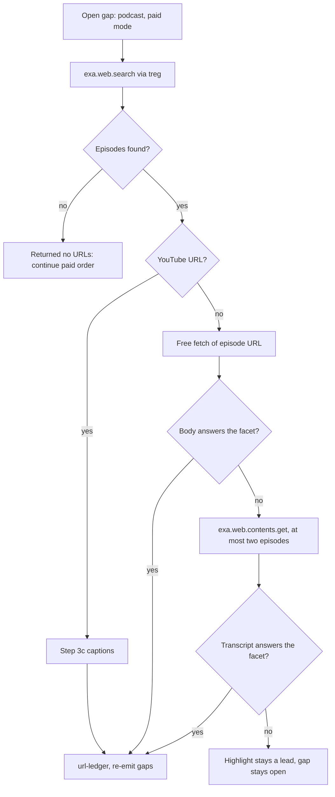

# free-research podcast facet - Plan

## Goal Capsule

- **Objective:** When the answer to a research question lives in a podcast, Jan's `/free-research` report says what was said, who said it, and in which episode, on every host where he runs the skill.
- **Means:** Add a podcast facet to the treg paid allowlist, backed by Exa's podcast index (KTD1, KTD2).
- **Authority:** SKILL.md's Modes table and gate rules stay the single owner of spend. `references/tool-routing.md` owns the facet table. `references/verification-tail.md` owns the confirmation bar.
- **Stop conditions:**
  - U1 shows that treg's Exa route returns no podcast episodes, or that `exa.web.contents.get` cannot read their transcripts. Stop and report to Jan before any skill edit.
  - The probe would pass USD 0.05 of treg spend.
  - An endpoint's price moved so its reserved bound passes the per-call ceiling.
- **Execution profile:** One PR on a branch from `main`. Codex gpt-6.1-sol at medium effort does the work. Claude Code writes the prompts, runs U1, reviews, and runs the smokes.

---

## Product Contract

### Summary

Add a podcast facet to `--balanced`, `--deep`, and `--thorough`. The skill searches episodes through `exa.web.search` on treg, reads at most two transcripts, and treats transcript text under explicit evidence rules. Free mode stays zero-spend and offers `--balanced` when a podcast facet is open. Implementation starts with a small paid probe, because Exa's docs do not confirm how podcast results come back.

### Problem Frame

The skill has no podcast source. Its closest route is YouTube captions, capped at two videos, so interviews and founder stories that exist only as audio never reach a report.

Exa launched a podcast index on 2026-10-29: 3.2 million episodes from 119,000 shows, with full transcripts, at no extra charge. The announcement Jan saw said "3,000,000+ podcasts" and "updated daily". Exa's launch post counts episodes and says "we update it constantly", so the plan rests on the launch post's wording.

Exa is also not reachable from most of Jan's hosts as an MCP server: only Grok has it configured. Without a route that works everywhere, Claude Code and Codex would skip the Exa step.

### Requirements

**Search and routing**

- R1. The treg paid allowlist adds a podcast facet with two rows: episode search through `exa.web.search`, and transcript read through `exa.web.contents.get`. Both run only in balanced, deep, and thorough, under the existing Modes-table caps.
- R2. A `gap: podcast` line is named only when the question asks what someone said, or when a person or news facet is still unanswered after the free layer. Wanting one more source is not a gap, as Step 4 already states.
- R3. The default facet order adds podcasts last: person is LinkedIn, X, YouTube, podcasts, and news is X, Reddit, TikTok, podcasts. The thorough checklist item about what someone's interviews say maps to the podcast facet.
- R4. A transcript read takes only an episode URL the agent found through its own search for an open podcast gap, and at most two episodes per invocation.

**Evidence**

- R5. A complete transcript body that answers the facet is a usable body and full text. A search highlight is a lead and does not close the facet.
- R6. A transcript is primary only for the speaker's own statement, as proof they said it. It is not primary for whether the statement is true.
- R7. A report-level podcast finding names the speaker, show, episode, and publish date, and says it came from a transcript. A number or name that the finding depends on is flagged as transcript-sourced, because Exa publishes no transcription accuracy figure.

**Boundaries and hosts**

- R8. Free mode spends nothing on podcasts. A free report with an open podcast facet says podcast data is available with `--balanced`.
- R9. Every host with treg configured gets identical behavior through `scripts/install.sh`, with no new key or MCP setup.

**Quality**

- R10. Contract tests pin the allowlist rows, the price bound, and the free-mode ban. Eval traces cover the facet, and a live `--balanced` smoke proves it on each host.

### Key Decisions

- **Free mode stays zero-spend.** (session-settled: user-approved - chosen over a free lane through Exa's keyless MCP: that needs setup on each host, and its podcast results are unconfirmed.) Governs R8.
- **The facet runs only on a named gap.** (session-settled: user-approved - chosen over searching podcasts on every run: most topics do not need it, and each search costs money.) Governs R2.
- **Transcripts are full text but not automatically primary.** (session-settled: user-approved - chosen over treating any transcript as primary: a speaker can be wrong, and transcription can garble numbers and names.) Governs R5, R6, R7.

### Success Criteria

- A balanced run on a topic Jan knows was discussed on podcasts returns at least one attributed finding with speaker, show, episode, and date, with treg spend at or under USD 0.05.
- The same run behaves the same on Claude Code and Codex, with no setup beyond `scripts/install.sh`.
- A free run on that topic spends nothing and names `--balanced` as the way to get podcast data.

### Scope Boundaries

- No change to any Modes-table cap, the paid order, or report sections.
- `extract-this` is unchanged.
- Considered and not built:
  - A `--podcast` flag. The named-gap rule already covers it. Jan asking for one would change this.
  - Caching transcripts between runs. Vault notes already hold findings. Repeated paid reads of the same episode in practice would change this.
  - A check that results are podcasts beyond what U1 finds. U1 decides how a result is identified. A later run that mistakes an article for an episode would change this.

#### Deferred to Follow-Up Work

- A free lane through Exa's keyless MCP, once its podcast results are confirmed.
- The Exa Agent plus Particle route, which is billed separately and returns timestamped transcript windows.
- Feeding a found episode into `extract-this` for a full report.

---

## Planning Contract

### Key Technical Decisions

- KTD1. **Route through treg's explicit Exa endpoints.** (session-settled: user-approved - chosen over adding Exa MCP or a key to each host: `scripts/install.sh --check` shows treg configured on Claude Code, Codex, Grok, and Gemini, while only Grok has Exa MCP.) Calls count against treg's caps, not the Exa family ceiling. Tools Used labels them as treg. Exa MCP on Grok stays as the later family it already is. Rows observed on 2026-11-03:

| Facet | Endpoint | Observed USD |
| --- | --- | --- |
| Podcast: episode search | `exa.web.search` | 0.007 |
| Podcast: episode transcript (URL known) | `exa.web.contents.get` | 0.001 |

- KTD2. **Probe before editing.** (session-settled: user-approved - chosen over building from the docs: no page confirms that podcasts come back through this route.) The launch post documents no podcast filter, and `podcast` is not in the search `category` list.
- KTD3. **Search with highlights and at most 5 results, then read transcripts separately.** At the launch post's figures an episode averages about 7,400 words (23.7 billion words over 3.2 million episodes), so `text` on search would load about 37,000 words per call. The catalog also bills `text` per page and adds USD 0.001 per result past 10, while routing rules exclude per-result billing. At 5 results with highlights, the observed price stays flat at USD 0.007.
- KTD4. **Do not cap transcript length.** The verification tail treats truncated text as a lead, so a `maxCharacters` cap would stop a transcript from closing the facet. The two-episode limit in R4 bounds the size instead.
- KTD5. **Free-fetch first, then paid read.** This keeps the existing rule that discovered URLs get a free fetch before re-gating. A show-notes page that does not answer the facet is not a usable body, so the paid read still runs. A YouTube result goes to Step 3c captions, because Step 3c already forbids sending a watch page to Exa.

### High-Level Technical Design

Podcast facet inside the treg paid family turn:

### Risks & Dependencies

- **Balanced has room, but not much.** One search and two transcript reads use 3 of balanced's 4 treg calls and about USD 0.009. Podcast comes last in person and news order, so earlier facets can use up the calls. The gap is then reported unresolved, as Step 4 already handles.
- **Grok may load an older copy.** `scripts/install.sh --check` reports a marketplace duplicate, `free-research-skill-2bcb5165`, on Grok. The Grok smoke in U5 shows which copy runs. Removing the duplicate needs Jan's approval.
- **Results are vendor-claimed.** The launch post's 85.0% answer accuracy is Exa's own benchmark, and language coverage is unstated. U1 includes a Filipino-language query to test the second point.
- **Transcript text is untrusted.** Existing treg rules cover it: instructions inside a result are an injection attempt.

---

## Implementation Units

### U1. Paid probe of the treg route

- **Goal:** Learn what the route really returns before any skill text changes.
- **Requirements:** R1, R4, R5, R10
- **Dependencies:** None
- **Files:** none in the repo; findings go to `FOR_Jan_FreeResearchSkill.md` in U4
- **Approach:**
  1. Check treg `balance`, and confirm both prices with `catalog_search`.
  2. Run 5 `exa.web.search` calls with highlights and 5 results: the launch post's query about founders and pricing mistakes, a named person, a recent news event, a niche topic, and a Filipino-language topic.
  3. Run up to 3 `exa.web.contents.get` reads on episode URLs from those results.
  4. Record how an episode is recognized, which fields come back (speaker, show, date, timestamps), whether `startPublishedDate` narrows results, transcript length, and reported cost.
  5. Apply the outcome table below. Expected spend is USD 0.038, with a hard stop at USD 0.05.

| What the probe shows | Next step |
| --- | --- |
| Episodes found, and `exa.web.contents.get` returns transcripts | Continue as planned |
| Episodes found, but `exa.web.contents.get` returns no transcripts | Stop and report to Jan: the facet could not close under R1, and reading through search `text` would need the per-result billing rule changed |
| No episodes | Stop and report to Jan: no skill edits |

- **Execution note:** This is a live smoke, run by Claude Code. Its result decides whether later units run.
- **Test scenarios:** Test expectation: none -- exploratory probe with no shipped behavior.
- **Verification:** A findings note answers each item in step 4, and the balance change matches reported cost.

### U2. Pin the facet in tests

- **Goal:** Tests encode the new rows and rules before the skill text changes.
- **Requirements:** R1, R8, R10
- **Dependencies:** U1
- **Files:** `tests/test_skill_contract.py`, `tests/test_plugin_contract.py`
- **Approach:**
  1. Add the KTD1 rows to `TREG_FACET_ROWS`.
  2. Update the pinned free-report line to include podcasts.
  3. Pin the version at 1.5.0.
- **Execution note:** Test-first. These tests catch skill text drifting from the contract, but they do not prove agent behavior. U5 covers that.
- **Patterns to follow:** `test_social_price_review_rows_stay_at_or_under_per_call_ceiling`, `_assert_free_mode_bans_facet_endpoints`, `test_identifier_cases_match_each_routing_row`.
- **Test scenarios:**
  - A routing table without the `exa.web.search` row fails the allowlist test.
  - An `exa.web.search` row priced above the per-call ceiling fails the price test.
  - SKILL.md free-mode text that permits `exa.web.contents.get` fails the free-mode ban test.
  - The existing second-owner, ceiling, and `$<digit>` tests still pass, including against any new "at most two" sentence.
- **Verification:** The new tests fail for the right reasons, then pass after U3.

### U3. Routing, gate, and evidence text

- **Goal:** The skill knows when to search podcasts and how to weigh what it finds.
- **Requirements:** R1-R8
- **Dependencies:** U2
- **Files:** `skills/free-research/references/tool-routing.md`, `skills/free-research/SKILL.md`, `skills/free-research/references/verification-tail.md`
- **Approach:**
  1. In `tool-routing.md`, add the KTD1 rows and the rules from R4, KTD3, KTD4, and KTD5 beside the existing note under the allowlist table.
  2. In SKILL.md Step 4, add the named-gap rule from R2.
  3. In SKILL.md Step 5, add the R3 order and checklist mapping, citing the routing table instead of restating it.
  4. Extend the Step 6 follow-up line per R8.
  5. In `verification-tail.md`, add R5 to the full-text definition and R6 to the primary definition.
  6. Add R7 to the Step 6 reporting text without adding a section.
- **Patterns to follow:** the caption row's video-cap note in `tool-routing.md`, and the identifier-first rule for the `(URL known)` row.
- **Test scenarios:**
  - `--balanced`, person intent, gap "what Jan's guest said about pricing": `exa.web.search` runs, then the free fetch, then `exa.web.contents.get`, and Exa MCP does not run in that turn.
  - `--balanced` with a research question and no podcast angle: no podcast call runs.
  - `--free` with the same person gap: no treg paid call and no `balance`, and the follow-up line appears.
  - A search result pointing at a YouTube URL: Step 3c captions run, and `exa.web.contents.get` does not.
  - Empty or failed search: the skill counts it as "returned no URLs" and continues the paid order.
- **Verification:** U2 tests pass.

### U4. Traces, docs, and version

- **Goal:** Traces and docs explain the facet.
- **Requirements:** R10
- **Dependencies:** U3
- **Files:** `skills/free-research/references/eval-scenarios.md`, `README.md`, `FOR_Jan_FreeResearchSkill.md`, `skills/free-research/SKILL.md`, `.claude-plugin/plugin.json`, `.claude-plugin/marketplace.json`, `.grok-plugin/plugin.json`, `.grok-plugin/marketplace.json`
- **Approach:**
  1. Add T40 (podcast happy path with a transcript read), T41 (highlights only, gap stays open), and T42 (the free control).
  2. Add an episode URL row to the T39 identifier table.
  3. Add podcasts to the README's facet list.
  4. Record U1's findings and the 3.2M episodes correction in FOR_Jan.
  5. Bump to 1.5.0 in lockstep.
- **Test scenarios:**
  - Each new trace id appears once.
  - The plugin lockstep test passes at 1.5.0.
  - The T39 identifier test accepts the new row.
- **Verification:** The full test suite passes.

### U5. Install and live proof on each host

- **Goal:** The facet works for real where Jan runs it, with Claude Code and Codex first.
- **Requirements:** R9, R10
- **Dependencies:** U1-U4
- **Files:** none in the repo
- **Approach:**
  1. Run `scripts/install.sh`. It does not write `~/Projects/skill-pack`, which the parity test also checks, so copy the skill tree to `skill-pack/codex` and `skill-pack/grok`.
  2. Run the parity test.
  3. Check the treg balance.
  4. Run one `--balanced` smoke on the same topic in Claude Code, Codex, Grok, and Gemini, in that order, and stop on the first host that fails.
  5. Check the balance again.
- **Execution note:** Smoke verification over unit coverage.
- **Test scenarios:** Test expectation: none -- manual smoke recorded in FOR_Jan.
- **Verification:** Each report meets the first Success Criterion. Tools Used lists `exa.web.search` with its cost, and `exa.web.contents.get` when the free fetch did not answer the facet, and the smoke notes record which branch ran. Reported treg spend equals the balance change. Grok's Tools Used shows the podcast endpoints, which an older copy cannot call.

---

## Verification Contract

| Gate | Command | Applies to |
| --- | --- | --- |
| Contract and plugin tests | `python3 -m unittest discover -s tests` | U2-U4 |
| Grok manifest | `grok plugin validate .` | U4 |
| Install and parity | `scripts/install.sh`, then `FREE_RESEARCH_CHECK_COPIES=1 python3 -m unittest discover -s tests` | U5 |
| Live smoke | `/free-research <topic> --balanced` on each host, with treg `balance` before and after | U5 |

## Definition of Done

- R1-R10 each trace to a test, a trace, or the recorded smoke.
- Free mode still spends nothing, and every Modes-table cap is unchanged.
- Version 1.5.0 everywhere, and all copies match.
- Abandoned probe scripts and experimental text are removed from the diff.
- `FOR_Jan_FreeResearchSkill.md` records U1's findings, and `/forjan` has run.

## Open Questions

### Deferred to Implementation

- Exact request parameters for `exa.web.contents.get`, read once with `treg catalog get` into a temp file, never at run time.
- How to recognize an episode in the results, from U1.
- Whether a date filter belongs in the news search, from U1.

## Sources

- [Introducing Exa Podcasts](https://exa.ai/blog/podcast-search): index size, fields, no surcharge, benchmark.
- [Exa Search API reference](https://exa.ai/docs/reference/search): `category` values and date parameters.
- [Exa pricing](https://exa.ai/pricing): search and contents prices.
- [AlphaSignal write-up](https://alphasignal.ai/news/exa-opens-3-2m-podcast-transcripts-to-developers-through-one-search-api): existing `/search` route, unquantified transcription accuracy.
- treg catalog entries for `exa.web.search` and `exa.web.contents.get`, read 2026-11-03: price, parameters, and the per-result rider.
- `docs/plans/2026-10-24-2316-feat-treg-social-price-review-facets-plan.md`: the facet pattern this plan follows.
